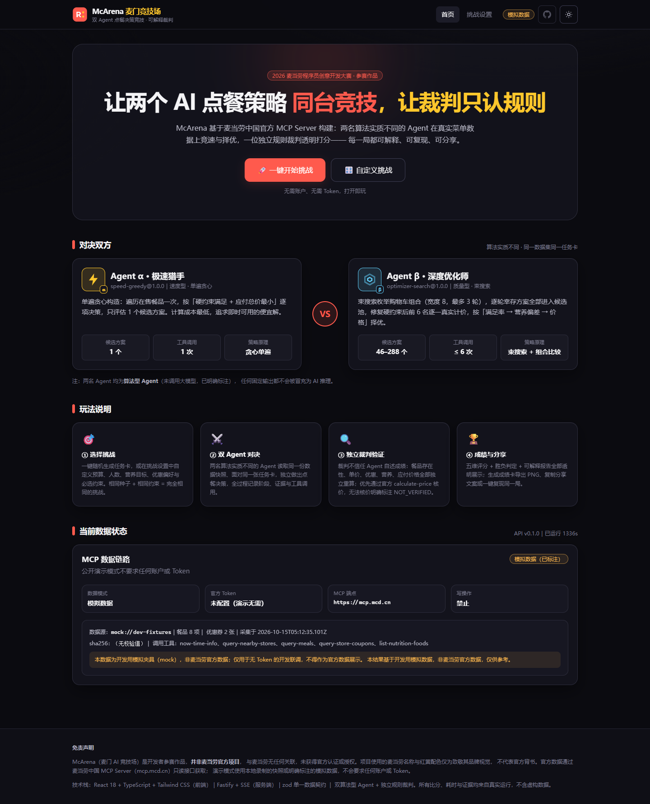
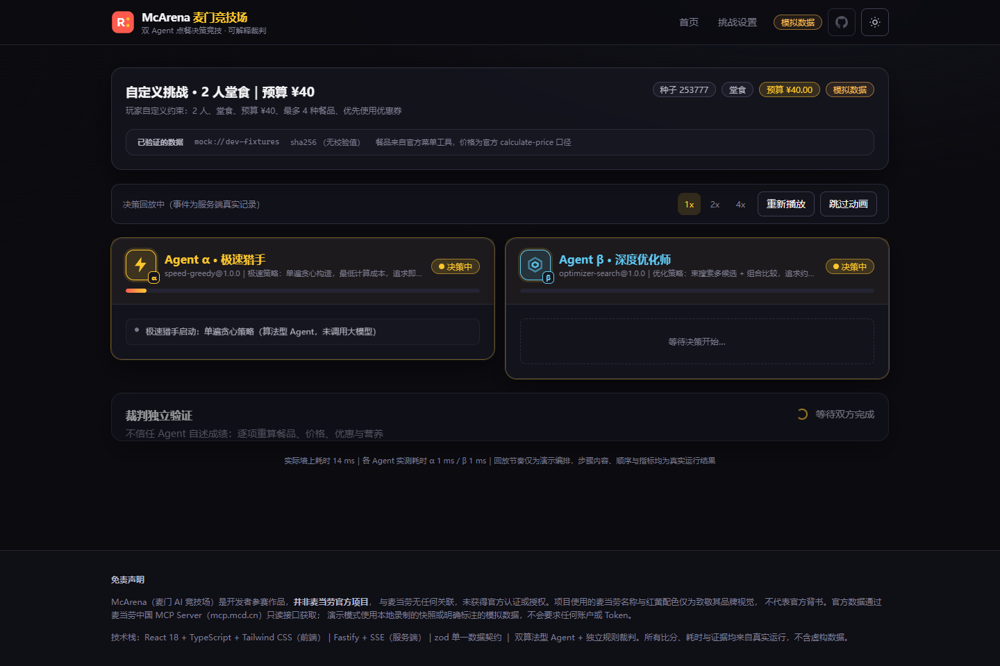
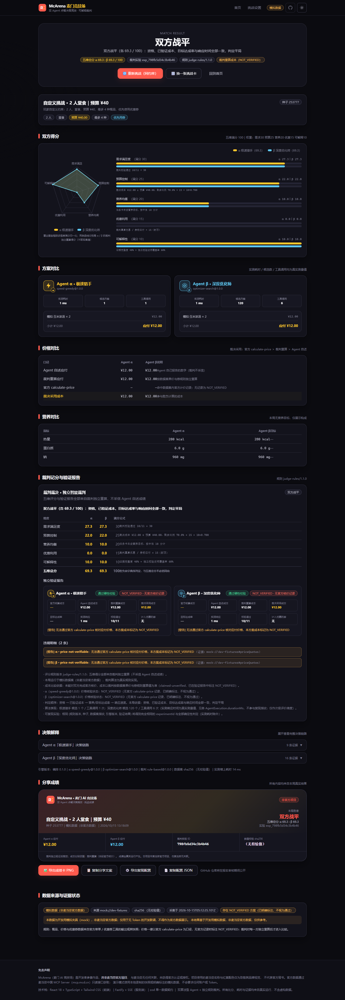
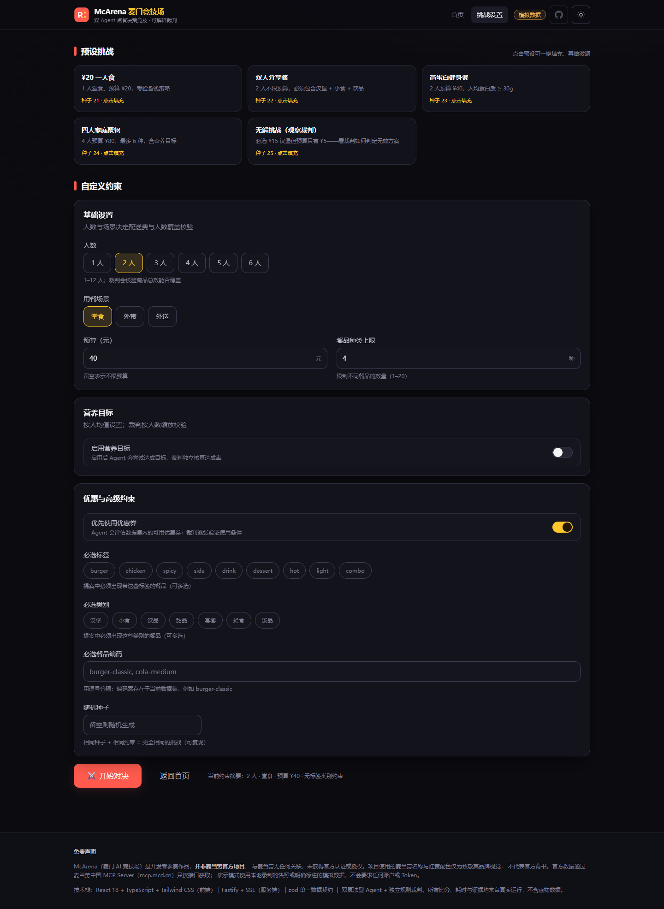
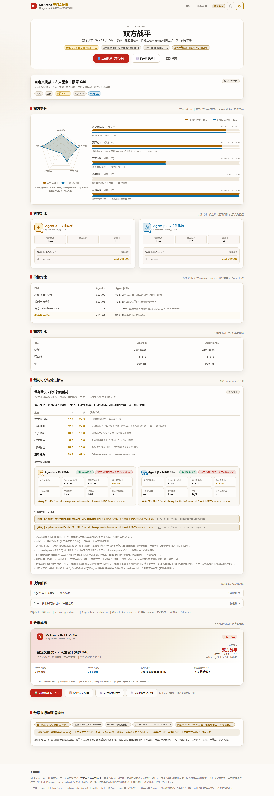
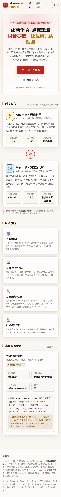

# McArena · 麦门 AI 竞技场

> 基于麦当劳中国 MCP 接入方案的**双 Agent 点餐决策竞技平台**——两种算法策略在同一任务卡与数据集上对决，独立裁判透明评分。公开演示使用明确标注的场景数据；官方 MCP 实时联调与返回 schema 校验尚未完成。

[](https://github.com/DorianChn/McArena/actions)


## 🖼 界面展示（真实截图）

以下截图来自**生产构建 + 真实 Chrome** 的 16 步链路实测（2026-10-15，控制台 0 错误 / 0 警告，证据见 [`docs/screenshots/stage07/`](docs/screenshots/stage07/)），非设计稿：

| 首页（深色） | 竞技场（回放中） | 结果页（五维对比） |
|---|---|---|
|  |  |  |
| 挑战设置 | 结果页（浅色） | 移动端 |
|  |  |  |

> 动态演示：20 帧真实会话采集帧见 [`docs/screenshots/gif-frames/`](docs/screenshots/gif-frames/)（采集器 [`tools/e2e/capture-demo-frames.mjs`](tools/e2e/capture-demo-frames.mjs) 可一键重采）。本环境不生成视频，GIF 合成命令见「[演示 GIF](#-演示-gif合成)」。

## 🎮 一局比赛是什么

一张任务卡（预算 × 人数 × 场景 × 约束）+ 两名风格迥异的点餐 Agent + 一位只认规则的裁判：

- ⚡ **Agent α「极速猎手」（Speed Agent）**：单遍贪心构造，只评估 1 个候选方案，用最低计算成本给出一个便宜、可预测的有效解；
- 🔬 **Agent β「深度优化师」（Optimizer Agent）**：束搜索枚举成百上千个候选购物车，逐一修复硬约束、按当前数据源计算价格，按「约束满足率 → 营养偏差 → 价格」择优；
- ⚖️ **独立智能裁判（Judge Engine）**：需求满足度 / 预算控制 / 营养均衡 / 优惠利用 / 可解释性，五维打分、公式公开、证据可查。裁判**不信任 Agent 自己报告的成绩**——餐品存在性、单价、优惠、营养、应付价格全部由裁判基于当前数据集独立重算；只有取得官方 `calculate-price` 结果时才按官方核价标记，否则明确标注 **NOT_VERIFIED**；出现致命违规的方案直接失去获胜资格，**无效方案不能凭低价取胜**；每局产出可复现的 `experimentId`。

两名 Agent 的算法**实质不同**（贪心 vs 束搜索），基准测试实测差异：平均候选数 1 vs 134、平均工具调用 1 vs 4.75 次；模拟数据下 α 更便宜、β 营养与用券更优。两者均为**算法型 Agent**（未配置大模型，已明确标注），不得把固定输出冒充 AI 推理。

默认演示模式使用仓内场景数据，并明确标注为模拟数据。项目已实现麦当劳 MCP 客户端与只读工具调用链，但尚未取得 Token，因此没有真实菜单、价格或营养数据的联调证据；未经成功联调与校验的数据不会标为官方数据。

## ✨ 特性

- **麦当劳 MCP 集成（未完成实网验证）**：实现 Streamable HTTP 客户端与只读工具白名单；真实连接和工具 schema 待 Token 到位后验证；
- **可复现**：固定随机种子 + 数据快照哈希，同一局比赛任何人运行结果完全一致；
- **可解释**：裁判每项得分都附带公式与证据，独立验证报告逐条列出违规（severity + 数据证据引用），拒绝黑箱；
- **无 Token 也能玩**：默认使用仓内**场景数据集**（界面明确标注「模拟数据，非麦当劳官方数据」），克隆即可完整演示；完成字段映射与校验前，演示只使用明确标注的场景模拟数据；
- **安全**：只读工具白名单，默认禁止任何下单写操作；
- **WorkBuddy Skill**：在 WorkBuddy 对话里说「来一场麦门竞技」即可开赛（见 [`skill/mc-arena/INSTALL.md`](skill/mc-arena/INSTALL.md)）。

<!-- APPEND-MARKER -->

## 🔀 两种数据模式

| 模式 | 数据来源 | 需要 Token | 界面标识 | 用途 |
|---|---|---|---|---|
| **演示模式**（默认） | 仓内场景数据集 `scenario://stage03-fixtures` | ❌ 不需要 | 黄色「模拟数据」徽标 | 克隆即可完整走通全链路，适合体验、教学、CI |
| **官方数据模式（待联调）** | MCP Server 实时采集；原始快照的字段映射尚未完成 | ✅ 需要 | 仅在数据成功校验后显示官方来源 | 目标是使用官方菜单 / 价格 / 优惠 / 营养数据 |

- 演示模式输出中的每一处数据均带 `dataOrigin: mock`，绝不冒充官方数据；
- 快照采集工具目前只保存原始响应和 sha256 manifest，尚未完成将真实响应映射为比赛快照的步骤；
- **当前状态（如实说明）**：MCP 客户端协议层通过假服务器契约测试；真实 live 联调与官方 schema 验证尚未完成（BLOCKED：尚无 MCP Token），快照字段映射也待完成——详见 [MCP_INTEGRATION.md](MCP_INTEGRATION.md)。

## 🚀 快速开始

### 环境要求

- Node.js ≥ 20（开发使用 22.x）
- npm ≥ 10

### 一键启动（演示模式，无需 Token）

```bash
git clone https://github.com/DorianChn/McArena.git
cd McArena
npm ci
npm run dev
# 前端 http://localhost:5173 ｜ API http://localhost:8787
```

### 官方 MCP 原始响应采集（需要麦当劳 MCP Token；比赛映射尚未完成）

当前版本尚未完成真实 Token 联调、官方响应 schema 校验及快照字段映射，不能据此运行官方菜单上的完整比赛。取得 Token 后可按 [MCP_INTEGRATION.md](MCP_INTEGRATION.md) 采集只读原始响应；在映射与校验完成前，演示仍使用明确标记的场景模拟数据。

### 命令行竞技（无需启动服务，本地完整体验）

```bash
npm run demo                          # 打一局比赛，输出中文战报（任务卡/双 Agent 指标/裁判结论）
npm run bench                         # 跑 8 个官方测试场景，输出双 Agent 五维对比表
npm run demo -w @mcarena/arena-core -- timeout   # 演示：Agent 超时 → 降级恢复（明确标注）
npm run demo -w @mcarena/arena-core -- cancel    # 演示：取消执行 → CANCELLED，不产出提案
```

`--goal` 可选：`balanced` / `protein` / `low-sodium` / `low-cal` / `budget` / `none`；
`--mode` 可选：`auto`（默认；当前官方快照目录为空，运行使用场景数据集）/ `mock` / `replay` / `live`。

### 质量检查

```bash
npm run lint       # ESLint（typescript-eslint 类型感知规则）
npm run typecheck  # TypeScript strict 全量检查
npm test           # Vitest：契约 / 协议 / 编排 / API / 前端客户端
npm run build      # 生产构建（API tsup 打包 + Web Vite 构建）
```

### WorkBuddy 中使用

```bash
node skill/mc-arena/scripts/install.mjs          # 安装到 ~/.workbuddy-ai/skills/mc-arena
node skill/mc-arena/scripts/parse-request.mjs "3个人 预算60 要低卡 外带"
node skill/mc-arena/scripts/run-match.mjs --people 2 --budget 60 --goal balanced --seed 42
```

安装后在 WorkBuddy 对话中说「来一场麦门竞技，2 个人 60 块要均衡搭配」即可触发。
Skill 不含业务逻辑，全部调用仓库内共享引擎（与网页同源）。详见
[`skill/mc-arena/SKILL.md`](skill/mc-arena/SKILL.md)、[`skill/mc-arena/INSTALL.md`](skill/mc-arena/INSTALL.md)
与 [`STAGE_06_REPORT.md`](STAGE_06_REPORT.md)。开发过程记录见 [`workbuddy.md`](workbuddy.md)。

<!-- APPEND-MARKER-2 -->

## 🎯 可复现 Demo 挑战

一条命令跑一局完整的「自定义挑战 → 双 Agent 决策 → 独立裁判 → 可复现配置」闭环：

```bash
npm run challenge -w @mcarena/arena-core -- --people 2 --budget 60 --goal balanced --seed 42
```

真实输出（2026-10-15 实测，演示模式）：

```text
任务卡：自定义挑战 · 2 人堂食｜预算 ¥60、人均 500 kcal、人均蛋白 20g、必含标签 burger/side/drink
数据来源：mock（scenario://stage03-fixtures）｜比赛 ID match_mv9660tm_42
⚠ 阶段03 场景测试数据集（模拟数据，非麦当劳官方数据）

【α 极速猎手】speed-greedy@1.0.0｜总分 78.5/100
    自述应付 ¥22.00｜裁决成本 ¥22.00｜核价 not-verified｜资格 通过
    实测 7ms｜候选 1｜工具调用 1
【β 深度优化师】optimizer-search@1.0.0｜总分 79.6/100
    自述应付 ¥25.00｜裁决成本 ¥25.00｜核价 not-verified｜资格 通过
    实测 3ms｜候选 248｜工具调用 6

裁判结论：极速猎手胜出（五维总分 78.5 : 79.6 / 100）——双方均无官方核价记录（NOT_VERIFIED），按裁判重算成本比较，α更低（¥22.00 : ¥25.00）
规则 judge-rules/1.1.0｜实验 exp_bcc724febf31e0b8｜成本依据 claimed-unverified
```

同一 `seed` 重复运行得到**同一 `experimentId`**（该 ID 已在 2026-10-14 的阶段06 实测中复现）。输出末尾会给出 `reproducibleConfig`——粘贴到网页「挑战设置」或同种子重跑即可复现同一局。

## 📖 使用案例

1. **多人聚餐预算分配**：3 个人、¥60、要高蛋白——看 β 如何在 248 个候选里找出满足硬约束且营养偏差最小的组合，而 α 用 1 个候选闪电给出便宜解；
2. **「省钱 vs 吃好」的量化对比**：同一任务卡下，用裁判五维图表直接比较两种策略的预算控制 / 营养均衡 / 优惠利用得分；
3. **MCP 决策类应用的工程范本**：把「快照录制 + 规则裁判 + 证据链」三件套迁移到任何基于 MCP 的决策场景，用于回归测试与公平评测；
4. **可解释 AI 教学演示**：雷达图 + 决策时间轴 + 逐项公式，让「Agent 如何点餐、裁判如何打分」肉眼可见；
5. **WorkBuddy 对话内开赛**：自然语言「来一场麦门竞技，2 个人 60 块要均衡搭配」即可触发完整比赛并返回可分享战报。

## 🏗 技术架构

```
┌────────────┐   ┌──────────────────┐   ┌─────────────────────────┐
│ apps/web   │──▶│ apps/api         │──▶│ packages/arena-core     │
│ React+Vite │   │ Fastify + SSE    │   │ 规则/双Agent/裁判(纯函数) │
└────────────┘   └──────────────────┘   └───────────┬─────────────┘
                            │                       │ packages/shared (zod 契约)
                  ┌─────────▼──────────┐   ┌────────▼─────────┐
                  │ snapshots/ (回放)  │◀──│ mcd-mcp-client   │──▶ mcp.mcd.cn
                  └────────────────────┘   └──────────────────┘
```

- **单一事实来源**：`packages/shared` 用 zod 定义跨模块契约（MenuSnapshot / TaskCard / DecisionTrace / Verdict / MatchRecord），API 与 Web 两端共享；
- **三端同源**：网页 API、CLI、WorkBuddy Skill 共用同一 `runArenaMatch()`（`arena-core`），Skill 不复制业务逻辑；
- **数据三分法**：`official-live` / `official-snapshot` / `mock`，由 `DataOrigin` 贯穿 MatchResult 与 UI；
- **写操作红线**：MCP 客户端只读白名单 + 写操作黑名单双重机制，默认拒绝一切下单类工具（单测覆盖）。

详细设计见 [ARCHITECTURE.md](ARCHITECTURE.md)，实施计划见 [PROJECT_PLAN.md](PROJECT_PLAN.md)。

<!-- APPEND-MARKER-3 -->

## 🧪 测试与质量

```bash
npm test      # Vitest：契约 / 协议 / 决策 / 裁判 / 复现性 / API / 前端 / E2E 辅助
npm run build # TypeScript strict 全量构建
```

复现性测试：相同 `(seed, snapshotId)` 两次运行的 MatchRecord（除记录 ID 外）字节级一致。

当前基线（2026-10-15 真实执行）：

- **测试 222/222 通过（22 个文件）**：含并发挑战可回放、同 seed 并发逐字节一致、SSE 404 语义、MatchStore 容量淘汰、空菜单可判决、限流 / 退避 / 401 不重试、Skill 子进程集成（11 项）、快照采集与落盘（7 项）等；
- **TypeScript strict 0 错误；ESLint 0 错误 / 0 警告**（CLI `no-console` 与 react-refresh 两处为精确豁免并附注释）；
- **`npm audit` 0 漏洞**（全量与 `--omit=dev`）；
- **浏览器实测**：生产构建 + 真实 Chrome + playwright-core，16 步全链路通过，控制台 **0 错误 / 0 警告**，移动端无横向溢出（证据 `docs/screenshots/stage07/`）。

## 📁 目录结构

| 路径 | 说明 |
|---|---|
| `packages/shared` | 数据契约（zod schema + TS 类型，单一事实来源） |
| `packages/mcd-mcp-client` | 官方 MCP Streamable HTTP 客户端（退避重试 / 写操作黑名单 / 快照采集） |
| `packages/arena-core` | 竞技内核：规则引擎、双 Agent、裁判引擎（零网络纯函数）+ `challenge` CLI |
| `apps/api` | Fastify 服务：比赛 API + SSE 实时流 |
| `apps/web` | React 中文可视化界面（决策时间轴 / 雷达图 / 解释面板 / Agent 指标） |
| `skill/mc-arena` | WorkBuddy Skill（SKILL.md + scripts + references + INSTALL.md） |
| `snapshots/` | 官方数据快照目录（**当前为空**；空时自动回退场景数据集。采集：`MCD_MCP_TOKEN=<token> tsx tools/snapshot-capture.ts`，需 Token） |
| `docs/screenshots/` | 真实浏览器截图（stage05 / stage07 / gif-frames） |
| `docs/evidence/` | 各阶段真实运行证据（CLI 输出、HTML 战报、JSON 结果、浏览器实测报告） |
| `docs/PROMOTION.md` | 传播材料（中文介绍 / English / GitHub 描述 / 技术亮点 / 架构说明） |
| `tools/` | 工程脚本：快照采集 CLI、报名就绪自查、GIF 帧捕获、浏览器实测 |

### 阶段成果

- 阶段00/01：工程基座、共享契约、MCP 客户端、API 与前端（提交 `23767dc` / `f5b301f`）
- 阶段02：官方 MCP 接入层（只读白名单、429 退避、限流、快照回放）
- 阶段03：双 Agent 竞技引擎（Speed / Optimizer + 执行状态机 + 基准测试）——见 [`STAGE_03_REPORT.md`](STAGE_03_REPORT.md)
- 阶段04：独立智能裁判系统（独立验证 / 资格硬门槛 / 官方核价优先 / 可复现实验 ID）——见 [`STAGE_04_REPORT.md`](STAGE_04_REPORT.md) 与 [`JUDGE_SPEC.md`](JUDGE_SPEC.md)
- 阶段05：完整前端 UI/UX（四页面 / 双主题 / 响应式 / 分享卡 / 无障碍；API 契约支持自定义挑战）——见 [`STAGE_05_REPORT.md`](STAGE_05_REPORT.md)（含真实浏览器实测与截图）
- 阶段06：WorkBuddy Skill 集成（任务卡构造下沉共享引擎 / `challenge` CLI / Skill 三脚本 / 官方规范校验通过）——见 [`STAGE_06_REPORT.md`](STAGE_06_REPORT.md)
- 阶段07：完整质量保证、安全审计与稳定性修复（lint 31→0、测试 215→222、audit 4→0、16 步浏览器实测）——见 [`STAGE_07_REPORT.md`](STAGE_07_REPORT.md) / [`TEST_REPORT.md`](TEST_REPORT.md) / [`SECURITY_AUDIT.md`](SECURITY_AUDIT.md) / [`PERFORMANCE_REPORT.md`](PERFORMANCE_REPORT.md)
- 阶段08：参赛文档、演示与发布前整理——见 [`FINAL_WORKBUDDY_REPORT.md`](FINAL_WORKBUDDY_REPORT.md) 与 [`CODEX_HANDOFF.md`](CODEX_HANDOFF.md)

## 🎯 适用人群

- 想了解 MCP 真实落地的开发者；
- 对「多智能体决策 / 可解释 AI / 公平比对」感兴趣的学习者；
- 需要「点餐决策辅助」思路参考的产品与技术团队。

## 🔌 实际使用的麦当劳 MCP 工具

`now-time-info`、`query-nearby-stores`、`query-meals`、`query-meal-detail`、`calculate-price`、`query-store-coupons`、`list-nutrition-foods`、`campaign-calendar`。
调用流程与业务价值详见 [MCP_INTEGRATION.md](MCP_INTEGRATION.md)。

## 🎞 演示 GIF（合成）

本仓库不内置二进制 GIF：20 帧真实采集帧位于 [`docs/screenshots/gif-frames/`](docs/screenshots/gif-frames/)（按文件名排序即为播放顺序）。在装有 ffmpeg 的机器上一条命令即可合成：

```bash
ffmpeg -framerate 2.5 -i docs/screenshots/gif-frames/%03d-*.png \
  -vf "scale=960:-1:flags=lanczos,split[s0][s1];[s0]palettegen[p];[s1][p]paletteuse" \
  docs/screenshots/demo.gif
```

（帧由 `node tools/e2e/capture-demo-frames.mjs` 真实采集，未经任何画面伪造；本环境不生成视频，故不在仓库内置 GIF。）

## ⚠️ 合规与免责

- 本项目为麦当劳程序员创意开发大赛参赛作品，非麦当劳官方产品；输出仅供娱乐与学习参考，不构成营养或专业建议；
- 项目**默认禁止**调用 `create-order` 等写操作，不会产生任何真实订单；
- Token 仅通过环境变量注入，仓库内不含任何真实凭据；
- 餐品、价格与供应情况以麦当劳官方渠道实时结果为准。

## 📄 License

[MIT](LICENSE)


